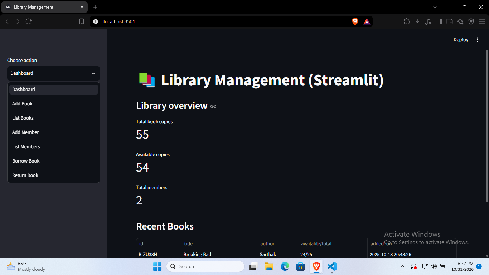

# 📚 Library Management System (Streamlit)

A clean, modern, and interactive **Library Management System** built with Python and **Streamlit**. This application helps manage book inventories, library members, and track book borrowing and returning operations efficiently. It's UI is simple so any one can add, borrow and list the books. 

## 📸 Preview



---

## ✨ Features

* **📊 Dashboard Overview:** Real-time metrics showing total book copies, available copies, total members, and a quick glance at recent books.
* **📖 Book Management:** 
  * Add new books to the library inventory.
  * List and search through existing books.
  * Also, borrow books from library inventory
* **👥 Member Management:** 
  * Register new library members.
  * View the list of active members.
* **🔄 Circulation (Borrow/Return):** 
  * Seamlessly process book borrowing and returns.
  * Track book availability status in real-time.

---

## 🛠️ Tech Stack

* **Frontend & UI:** [Streamlit](https://streamlit.io/)
* **Language:** Python

---

## 🚀 Getting Started

Follow these instructions to set up and run the project locally on your machine.

### Prerequisites

Make sure you have Python and Streamlit installed (Python 3.8 or higher recommended).

### Installation

1. **Clone the repository:**
   ```bash
   git clone [https://github.com/your-username/library-management-streamlit.git](https://github.com/your-username/library-management-streamlit.git)
   cd library-management-streamlit
